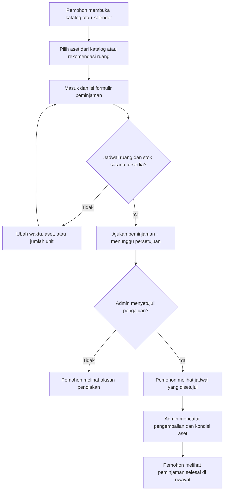
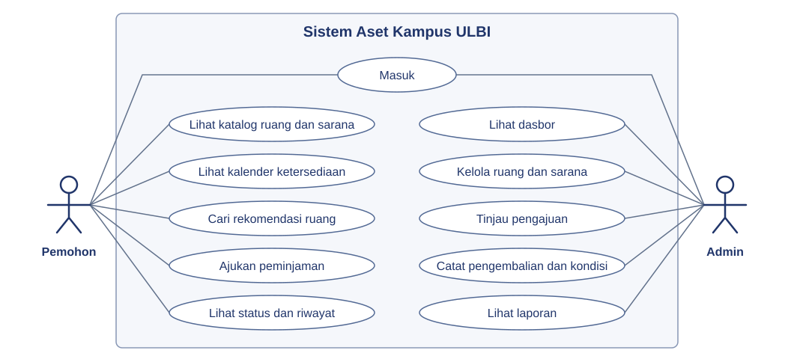

# Alur Prototipe Sistem Aset Kampus ULBI

Beranda, kalender, pencarian ruang, katalog ruangan, dan halaman Jadwal dan Stok sudah bisa dicoba. Diagram berikut menggambarkan alur lengkap yang dituju pada tahap prototipe. Tampilan registrasi, login dua peran, dan pemulihan kata sandi juga bisa dicoba sebagai simulasi dengan validasi di browser. Katalog sarana, pengajuan, persetujuan, pengembalian, dan laporan masih berupa rancangan layar dengan data contoh.

## Peran

| Peran | Kegiatan |
| --- | --- |
| Pemohon | Melihat katalog dan kalender, mencari ruang yang sesuai, mengajukan ruang dan/atau sarana tambahan, serta melihat status dan riwayat. |
| Admin | Melihat dasbor, mengelola data ruang dan sarana, meninjau pengajuan, mencatat kondisi saat pengembalian, dan melihat laporan. |

Fasilitas bawaan seperti AC dan proyektor terpasang tercatat pada ruangan dan dapat dipilih saat mencari ruang. Sarana tambahan seperti set tiang dan tatakan bendera, sofa dosen, atau meja tamu tercatat di katalog sarana. Pemohon memilih jumlah unit yang diperlukan di formulir peminjaman.

## User flow peminjaman

Pada pencarian ruang, Best-Fit mengurutkan ruang yang tersedia, memenuhi kebutuhan fasilitas, dan cukup untuk peserta berdasarkan sisa kursi paling sedikit. Bila jam pemakaian bertabrakan dengan peminjaman lain, ruang tersebut dikeluarkan dari hasil pencarian. Pemeriksaan stok sarana per jam pemakaian masuk dalam rancangan alur pengajuan.

## Keadaan yang perlu ditampilkan

| Keadaan | Respons tampilan |
| --- | --- |
| Jadwal ruang bentrok | Tampilkan jam yang bertabrakan dan arahkan pemohon untuk mengubah waktu atau memilih ruang lain. |
| Stok sarana kurang | Tampilkan jumlah diminta dan jumlah tersedia agar pemohon dapat menyesuaikan pengajuan. |
| Isian tidak valid | Beri pesan dekat isian yang perlu diperbaiki, misalnya jam selesai harus setelah jam mulai. |
| Data kosong | Beri keterangan sesuai halaman, misalnya tidak ada ruangan yang cocok atau belum ada riwayat peminjaman. |

## Use Case Diagram

[Rincian aktor, use case, dan skenario peminjaman](use-case.md).

