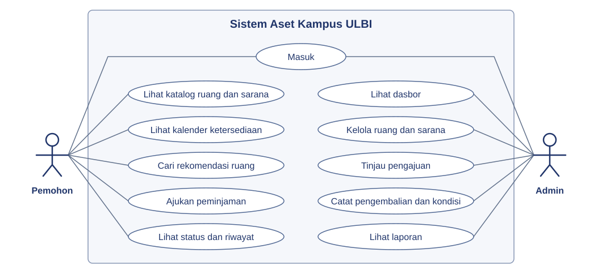

# Use Case Sistem Aset Kampus ULBI

Rancangan ini mencakup aplikasi yang dituju dalam proyek **Sistem Alokasi dan Peminjaman Aset Kampus Berbasis Web Menggunakan Best-Fit dan Interval Conflict Detection (Studi Kasus: ULBI)**. Implementasi halaman dilakukan bertahap.

## Aktor dan peran

| Aktor | Pengguna dan tanggung jawab |
| --- | --- |
| Peminjam | Mahasiswa, dosen, atau staf yang memerlukan ruangan dan/atau sarana kampus. Mengisi kebutuhan, memilih aset, mengajukan peminjaman, dan memantau pengajuannya sendiri. |
| Admin Logistik | Petugas yang mengelola data aset, meninjau pengajuan, menyetujui atau menolak peminjaman, serta memeriksa dan mencatat pengembalian dan kondisi aset. |

Mahasiswa, dosen, dan staf dikelompokkan dalam peran Peminjam karena rancangan awal memberikan fitur peminjaman yang sama kepada ketiganya. Pengelolaan aset dan persetujuan ditempatkan pada Admin Logistik sesuai cakupan proyek saat ini. Pembagian ini dapat disesuaikan setelah alur kerja unit logistik ULBI dikonfirmasi.

## Diagram

Setiap oval menunjukkan satu tujuan pengguna. Garis menghubungkan aktor dengan fitur yang dipakainya. Kotak menunjukkan batas aplikasi. Posisi oval dan garis asosiasi menunjukkan akses fitur, tanpa menyatakan urutan pelaksanaan.

## Daftar use case

| ID | Use case | Aktor | Hasil yang dituju |
| --- | --- | --- | --- |
| UC-01 | Masuk dan keluar akun | Peminjam, Admin Logistik | Pengguna mengakses fitur sesuai perannya dan mengakhiri sesi. |
| UC-02 | Melihat katalog dan detail aset | Peminjam | Mengetahui kapasitas dan fasilitas bawaan ruangan, serta stok dan kondisi sarana. |
| UC-03 | Melihat kalender ketersediaan | Peminjam | Mengetahui slot ruangan pada tanggal yang dipilih. |
| UC-04 | Mencari rekomendasi ruang | Peminjam | Mendapat pilihan ruang sesuai tanggal, jam, jumlah peserta, dan fasilitas. |
| UC-05 | Mengajukan peminjaman | Peminjam | Mengajukan ruangan dan/atau sarana beserta waktu, tujuan penggunaan, dan jumlah unit. |
| UC-06 | Melihat status dan riwayat sendiri | Peminjam | Mengetahui hasil pengajuan, alasan penolakan, dan peminjaman yang selesai. |
| UC-07 | Melihat dasbor | Admin Logistik | Mengetahui ringkasan aset dan peminjaman yang perlu ditindaklanjuti. |
| UC-08 | Mengelola ruangan | Admin Logistik | Memperbarui data ruangan, kapasitas, fasilitas bawaan, kondisi, dan statusnya. |
| UC-09 | Mengelola sarana | Admin Logistik | Memperbarui jenis sarana, stok, kondisi, dan status aset. |
| UC-10 | Menyetujui atau menolak pengajuan | Admin Logistik | Menetapkan keputusan berdasarkan kebutuhan, ketersediaan ruang, dan stok sarana. |
| UC-11 | Mencatat pengembalian dan kondisi | Admin Logistik | Mencatat jumlah dikembalikan, kondisi aset, dan penyelesaian peminjaman. |
| UC-12 | Melihat dan mengekspor laporan | Admin Logistik | Mendapat laporan peminjaman dan pengembalian dalam PDF atau Excel. |

## Skenario pengajuan peminjaman

1. Peminjam melihat katalog atau kalender.
2. Jika memerlukan rekomendasi ruang, peminjam mengisi tanggal, jam mulai, jam selesai, jumlah peserta, dan fasilitas yang dibutuhkan.
3. Sistem menampilkan ruang yang memenuhi kebutuhan dan tersedia pada waktu tersebut, diurutkan menggunakan Best-Fit.
4. Peminjam masuk ke akun untuk mengisi pengajuan. Peminjam memilih ruangan dan/atau sarana, jumlah unit, serta tujuan penggunaan.
5. Sistem memeriksa kelengkapan isian, jadwal yang bertabrakan, dan stok sarana pada rentang waktu penggunaan.
6. Pengajuan yang valid mendapat status **Menunggu persetujuan**.
7. Admin Logistik meninjau pengajuan dan memeriksa kembali ketersediaan sebelum memberi keputusan.
8. Peminjam melihat status **Disetujui** atau **Ditolak** beserta alasan penolakannya.
9. Setelah penggunaan selesai, Admin Logistik memeriksa pengembalian dan mencatat kondisi aset. Peminjaman yang telah diselesaikan tercatat pada riwayat.

| Kondisi alternatif | Respons aplikasi |
| --- | --- |
| Isian belum lengkap atau jam tidak valid | Beri pesan pada isian yang perlu diperbaiki. |
| Jadwal ruangan bertabrakan | Tampilkan konflik dan minta peminjam menyesuaikan waktu atau ruang. |
| Jumlah sarana melebihi stok tersedia | Tampilkan jumlah tersedia agar peminjam menyesuaikan jumlah, waktu, atau aset. |
| Pencarian tanpa hasil | Tampilkan keterangan dan arahkan pengguna mengubah kebutuhan pencarian. |
| Pengembalian belum lengkap atau aset rusak | Admin mencatat jumlah dan kondisi sebenarnya. Penyelesaian peminjaman mengikuti hasil pemeriksaan. |

## Fasilitas dan sarana tambahan

Fasilitas bawaan seperti AC dan proyektor terpasang menjadi bagian dari data ruangan. Sarana tambahan seperti set tiang dan tatakan bendera, sofa dosen, dan meja tamu dipilih berdasarkan jumlah unit yang dibutuhkan. Ketersediaan sarana diperiksa pada waktu peminjaman yang diajukan.

Best-Fit mengurutkan ruang yang memenuhi kebutuhan berdasarkan sisa kapasitas paling sedikit. Interval Conflict Detection memeriksa tumpang tindih waktu penggunaan. Keduanya merupakan proses di dalam aplikasi yang mendukung pencarian dan pemeriksaan pengajuan.

## Cakupan implementasi saat ini

Beranda, kalender, rekomendasi, katalog dan detail ruangan, katalog sarana, serta contoh bentrok jadwal dan stok kurang tersedia dengan data contoh. Formulir peminjaman menyediakan pilihan ruangan dan/atau sarana, lampiran PDF opsional, pemeriksaan isian, dan ringkasan yang dapat diubah. Jadwal ruang memakai data mingguan contoh, sedangkan stok sarana memakai jumlah tersedia tetap.

Tampilan registrasi, login Peminjam/Admin, dan pemulihan kata sandi tersedia dengan validasi di browser. Autentikasi, penyimpanan akun dan pengajuan, unggah dokumen ke server, email, riwayat, serta halaman Admin Logistik menjadi tahap pengembangan berikutnya.
